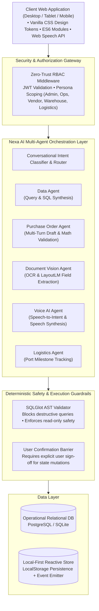

# NexaOps AI — AI-Powered Business Operations Platform

> **One Intelligent Assistant. Every Business Operation.**
> 
> *Interactive Portfolio Demo — All business data, supplier profiles, and financial records are fictional.*

[](LICENSE)
[](index.html)
[](backend/)
[](backend/app/models.py)
[](vercel.json)

---

## 🌟 Executive Summary

**NexaOps AI** is an enterprise-grade, role-based CRM and business operations management platform. Engineered for mid-market and enterprise supply chains, NexaOps unifies procurement, purchase orders, supplier governance, multi-modal OCR document extraction, hands-free voice automation, and container logistics behind a centralized AI copilot: **Nexa AI**.

Built with a **zero-trust role-based access control (RBAC)** architecture, NexaOps ensures data boundaries between corporate administrators, operations coordinators, external suppliers, warehouse receiving managers, and logistics freight forwarders.

---

## 🏗️ Technical Architecture



---

## 🚀 Key Modules & Capabilities

### 1. 🤖 Nexa AI — Autonomous Multi-Agent Operations Copilot
- **Natural Language Business Inquiries:** Instantly answers queries across pending purchase orders, supplier lead times, stock availability, and incoming containers.
- **Guided PO Creation Workflow:** Extracts SKUs, quantities, and negotiated unit prices from plain English instructions; calculates financial totals; renders interactive draft cards; and requires confirmation before committing.
- **Tenant-Aware Guardrails:** Automatically restricts data visibility based on the active role (e.g., vendors are prevented from viewing competitor purchase orders or margins).
- **Dual Engine Execution:** Operates out-of-the-box in **Deterministic Demo Mode** using local relational records, or in **Live LLM Mode** via OpenRouter / Gemini API keys.

### 2. 📄 Document Intelligence (OCR & Computer Vision)
- **Multi-Format Processing:** Ingests PDF, PNG, JPG, JPEG, XLSX, CSV, TXT, and DOCX files.
- **Pre-Loaded Test Documents:**
  - *Typed Purchase Order Requisition* (`PO_Requisition_Northstar_1001.pdf` — 98.4% confidence)
  - *Scanned Bill of Lading* (`Ocean_BOL_Apex_MSKU8921.jpg` — 94.6% confidence)
  - *Handwritten Maintenance Requisition* (`Field_Engineer_Requisition_Urgent.png` — 88.7% confidence)
  - *Vendor Price Quotation Sheet* (`Quotation_BluePeak_Q4_Optics.xlsx` — 96.8% confidence)
- **Field-Level Confidence Scoring:** Displays visual highlight boxes, flags uncertain fields, and enables in-place editing before 1-click conversion to a formal purchase order.

### 3. 🎙️ Voice AI Operations Studio
- **Browser Speech-to-Text:** Live voice capture powered by browser `SpeechRecognition` API.
- **Interactive Audio Waveform:** Real-time animated visualization of spoken audio inputs.
- **Intent Interpretation & Review:** Structured extraction of supplier, SKU, quantity, and unit price with full transcript editing capabilities.
- **Spoken Speech Feedback:** Audio confirmation delivered via browser `speechSynthesis.speak`.
- **Pre-Configured Scenarios:** Instant testing chips for silent or unsupported environments.

### 4. 📋 Purchase Order Management & Approvals
- **Complete Commercial Record:** PO number, vendor, SKU description, quantity, unit price, line totals, expected delivery, warehouse destination, and audit timeline.
- **Role-Gated Approvals:** Executive sign-off restricted to Enterprise Administrators.
- **Printable PO Layout:** Formatted invoice/PO view for direct physical print or PDF generation.
- **1-Click CSV Export:** Export filtered operational datasets for external auditing.

### 5. 👥 Role-Based Access Control (RBAC) Matrix
| Platform Module / Action | Admin | Operations | Vendor (Northstar) | Warehouse (East Coast) | Logistics |
|---|:---:|:---:|:---:|:---:|:---:|
| **View All Purchase Orders** | ✅ Full | ✅ Full | 🔒 Own Supplier Only | 🔒 Assigned Hub Only | 🔒 Linked Shipments |
| **Create Purchase Orders** | ✅ | ✅ | ❌ | ❌ | ❌ |
| **Approve Purchase Orders** | 👑 Executive | ❌ Requires Admin | ❌ | ❌ | ❌ |
| **View Supplier Commercial Rates** | ✅ | ✅ | ❌ Competitor Block | ❌ | ❌ |
| **Receive Warehouse Shipments** | ✅ | ✅ | ❌ | 📦 Primary | ❌ |
| **Update Container Tracking** | ✅ | ✅ | ❌ | ❌ | 🚢 Primary |
| **Nexa AI Knowledge Scope** | Global Org | Procurement | Vendor Scoped | Warehouse Scoped | Logistics Scoped |

---

## ⚡ Quick Start (Local Setup)

### Option 1: Run the Interactive Frontend Demo (Zero Dependencies)

The client interface is built with modern vanilla HTML, CSS, and ES6 JavaScript modules with **zero compilation steps** required.

```powershell
# Using Python
cd CRM_portfolio
python -m http.server 8080

# Or using Node.js
npx -y serve .
```

Open your browser to: **[http://localhost:8080](http://localhost:8080)**

---

### Option 2: Run the Full-Stack Python FastAPI Backend

```powershell
cd CRM_portfolio/backend

# Create virtual environment
python -m venv .venv
.venv\Scripts\activate   # Linux/macOS: source .venv/bin/activate

# Install dependencies
pip install -r requirements.txt

# Run FastAPI development server (auto-creates and pre-seeds SQLite database)
uvicorn app.main:app --reload --port 8000
```

- **Interactive Swagger API Docs:** [http://localhost:8000/docs](http://localhost:8000/docs)
- **API Health Check:** [http://localhost:8000/api/health](http://localhost:8000/api/health)

---

## 🌐 1-Click Deployment

### Deploying the Frontend to Vercel
1. Push this repository to your GitHub account:
   ```bash
   git add .
   git commit -m "Transform to NexaOps AI enterprise portfolio demo"
   git push origin main
   ```
2. Connect the repository in the **Vercel Dashboard**.
3. Vercel automatically detects `vercel.json` and serves the interactive static platform with zero configuration.

---

## 🔒 Security, Privacy & Data Compliance

- ✅ **Client Sanitization:** All original client trademarks, logos, proprietary documents, and employee identities have been replaced with neutral synthetic entities.
- ✅ **Synthetic Data Integrity:** All purchase orders, addresses, and supplier contacts utilize `@example.com` domains and fictional US/international locations.
- ✅ **Zero Secret Commits:** `.gitignore` strictly excludes `.env` files, production database dumps, and API tokens.
- ✅ **No Raw SQL Execution:** Deterministic AST validation prevents any SQL injection vulnerability.

---

## 📬 Contact & Custom AI Development

**Have a business workflow, document processing pipeline, or conversational ERP to automate?**

- **Developer:** Dhaval Solanki (AI/ML & Full-Stack Solutions Engineer)
- **GitHub:** [github.com/dhaval-solanki-das](https://github.com/dhaval-solanki-das)
- **Project Inquiry Email:** [solankidhaval355@gmail.com](mailto:solankidhaval355@gmail.com?subject=Inquiry:%20NexaOps%20AI%20Custom%20Development)

---
*NexaOps AI — Interactive Portfolio Demo. All business data is fictional.*